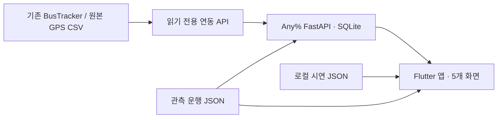

# Any% — 환승의 다음까지

울산과학대학교 앱개발과정 개인 프로젝트. 기존 BusTracker는 데이터 공급 서비스로 유지하고, 별도 FastAPI 백엔드와 Flutter 앱으로 전체 여정·환승·지연 영향을 비교합니다.

## 구성

- `app/`: Flutter, 장소·주소·지도 지점 선택, 로컬 데이터 계산과 API 연결, OpenStreetMap 지도·경로·정류장·기록 차량 및 오프라인 개략도
- `backend/`: 시간표 경로 탐색, 여정 단위 몬테카를로, REST API, BusTracker 정적 노선망 동기화
- `shared/network.json`: 계산 회귀 검증용 5개 가상 노선·9개 정류장. 일반 앱의 선택 항목에서는 제외
- `shared/observed_network.json`: 전체 256개 노선 ID·4,953개 정류장/참조 지점, 정제한 247개 노선의 1,187개 관측 운행 구간, 전체 노선 연결 정보와 공유 도로 형상
- `shared/route_recoveries.json`: 원본 해시·GPS 근접 추정 구간·7개 희소 ID의 조사 결과
- `shared/bustracker_catalog.json`: 원본 CSV의 정적 노선망 사본. 가상 시간표와 구분
- `shared/places.json`, `shared/walk_graph.bin`: OSM 장소·주소 37,427건과 접근 도보 계산용 로컬 보행망
- `tools/`: 데이터 준비, 실행·패키징 보조 도구
- `integration/bustracker/`: 기존 BusTracker에 추가한 연동 모듈과 최소 변경 패치



## 데이터와 모델

0.2.0은 **BusTracker 전체 노선·정류장**을 기본으로 사용합니다. 원본 노선 ID 257개·정류장 지점 ID 4,951개에서 ‘정보 없음’을 뜻하는 ID `0`만 제외해 256개 노선·4,950개 정류장을 목록과 검색에 포함했습니다. 같은 번호의 변형 노선 ID와 같은 장소의 중복 지점이 포함될 수 있습니다. 번호 미확인 노선은 원본 ID를 표시하고 이름 없는 정류장도 ID로 검색할 수 있습니다. 이전 A~E 가상 노선은 회귀 테스트에만 남아 있으며 API의 명시적 `dataset=demo`는 개발 검증용입니다.

기록된 운행시각으로 연결되면 도착시각과 지연 모델을 비교합니다. 연결되지 않으면 원본 정류장 순서로 **시각 없는 노선 연결 후보**를 탐색합니다. 이 후보에는 출발·도착시각·성공률을 만들지 않고 지연 시뮬레이션도 제공하지 않습니다. 환승 횟수와 도보 예산을 적용하며 동일 환승 횟수에서는 도로 거리와 보행량으로 정렬합니다. 원본에 정류장이 2개 미만인 ID는 7개였으며, 0.2.1에서 울주81의 짧은 GPS 추정 구간을 추가해 연결 후보가 있는 ID는 250개, 여전히 연결 자료가 부족한 ID는 6개입니다. 목록 포함이 모든 출발·도착 쌍의 연결이나 현재 실제 운행을 보장하지 않습니다. `artifacts/full-network-audit.json`에 검사 범위가 있습니다.

희소 ID는 버스 번호 전체의 누락과 다릅니다. 북구13 `195000130`, 울주07 `196000071`, 울주13 `196000131`은 같은 번호의 다른 ID에 경로가 있어 목록에서 ‘다른 구간 보기’를 제공합니다. 해당 부족 ID에 반대 방향의 정류장을 복사하지 않습니다. 울주61은 상방마을 부근에 머문 기록뿐이며, 번호 미확인 `195900010`은 통과 ID가 모두 0, `196000041`은 통과 ID 한 개뿐입니다. BusTracker의 DB 정류장 행도 같았고, 기존 인덱스로 다섯 시점씩 읽은 GPS 표본에서는 원본 CSV 외 새 좌표가 없었습니다. DB 전체 이력을 스캔한 것은 아닙니다.

울주81 `196000810`은 GPS가 이동해도 통과 ID가 고정되어 있었습니다. 추가로 가져온 BusTracker `bus_stops.csv`와 대조해 **남창고등학교 → 온양우체국 → 남창역(기점)** 3개 참조 정류장만 연결한 부분 구간을 복구했습니다. GPS 30m 이내·10km/h 이하·서로 80m 이상 떨어진 지점이라는 기준이며, 실제 정차·탑승이나 전체 노선을 확인한 것은 아닙니다. 앱은 ‘GPS추정’과 부분 구간 안내를 표시하고 도착시각·성공률은 제공하지 않습니다. 원본 4,950개 지점에 참조 정류장 3개를 추가해 총 4,953개입니다. 근거와 파일 해시는 `artifacts/missing-route-investigation.json`에 있습니다. 기존 BusTracker 파일·DB·서비스는 수정하지 않았습니다.

관측 리플레이는 **2025-12-31 07:00:00~07:59:59**, GPS 149,808행의 통과지점 변경을 이용합니다. 차량별로 시각을 정렬하고 같은 시각에 통과 지점이 충돌하는 895개 시각 그룹은 제외한 뒤 247개 노선의 1,187개 운행 구간을 추출했습니다. 기록된 시각은 문 열림·출발시각의 정확한 실측이 아닙니다. **지연 표본은 생성값**, 보행거리는 OSM 보행 도로망의 추정값입니다. 지점 반복 또는 8분 초과 공백에서 구간을 나누며, 하루 전체 시간표나 다음 차량을 외삽하지 않습니다.

Any%는 기준 도착시각, Safe는 시뮬레이션 90백분위 도착시각과 평균을 비교합니다. 시나리오의 지연은 동일 차량의 모든 정류장에 함께 적용됩니다. 연결 실패는 후속 차량을 선택해 최종 도착시간에 반영합니다. 탑승 여유는 30초입니다. 보행거리는 미리 등록한 환승 연결의 도로 형상 길이를 사용합니다. 최대 2회 환승, 보행 총량 한도, 막차 이후 경로 없음, 연결되지 않은 목적지를 처리합니다.

허용된 보행 연결로 목적지까지 마지막 구간을 걸을 수 있으며 가까운 정류장 간 도보만의 경로도 계산합니다. 보행 예산은 출발 접근·환승·도착 보행의 합에 적용합니다. 일반 보행 도로망의 최단경로를 제공하는 기능은 포함하지 않습니다.

확률은 시뮬레이션 표본의 추정이며 실제 정확도 또는 도착 보장이 아닙니다. Python과 Dart는 같은 계산 규칙을 쓰되 난수 생성기가 달라 통계가 다를 수 있습니다. 정류장별 탑승·보행 인덱스, 목적지까지 남은 환승 수의 역방향 도달 검사, 시간·보행·사용 노선을 고려한 지배 관계로 탐색하며 전체 상태를 500개로 자르던 제한은 제거했습니다. 도착시각 순 후보 20개에 대해 해당 여정에 사용되는 차량만 몬테카를로 계산합니다. 모든 위험 선호에 대한 전역 최적성을 보장하지는 않습니다. 후속 기록이 없으면 종료 결과로 분리하고 통계에는 비교용 페널티를 적용합니다.

서비스 종료 페널티는 `max(출발+240분, 1440분)`이며 **순위 비교용 정책값**입니다. 도착시각의 실측값으로 해석하면 안 됩니다. 종료 표본이 있으면 앱의 평균 도착을 ‘추정 불가’로 표시하며, 90백분위가 종료 표본에 걸쳐도 같은 안내를 제공합니다. 관측 모드의 ‘후속 차량 없음’은 자료 범위 밖임을 뜻하며 실제 막차 운행 종료를 뜻하지 않습니다.

## 실행

Python 3.10 이상과 Flutter stable이 필요합니다. 로컬 Python 3.12·Jetson Python 3.10에서 검증했습니다. 이 작업에서 내려받은 Flutter는 `../anypercent-tools/flutter/bin/flutter.bat`입니다.

```powershell
python -m venv .venv
.\.venv\Scripts\python -m pip install -r backend/requirements.txt
python tools/prepare_assets.py
.\.venv\Scripts\python -m uvicorn app.main:app --app-dir backend --host 127.0.0.1 --port 8001
```

다른 터미널:

```powershell
cd app
flutter pub get
flutter run -d chrome --web-port 8080
# Android: flutter run -d <device-id>
```

앱은 저장된 BusTracker 운행 기록으로 시작하며 서버 없이 경로를 계산합니다. 우측 상단 설정에서 백엔드 주소를 지정하거나 같은 운행 기록의 오프라인 사용으로 돌아갈 수 있습니다. Android 에뮬레이터는 `http://10.0.2.2:8001`, PC 웹은 `http://127.0.0.1:8001`입니다. 물리 휴대폰은 같은 LAN의 PC 주소와 서버 바인딩 설정이 필요합니다. 데모용 HTTP 연결만 허용하고 실제 공개 배포는 HTTPS를 사용합니다.

전체 노선망은 약 23.6MB JSON이며 API는 시작 시 직렬화한 응답을 재사용하고 gzip으로 압축합니다. 장소·주소 색인은 약 6.4MB, 보행망은 약 24.6MB입니다. 앱은 최대 20초 동안 연결을 시도하며, 서버 연결 없이도 같은 전체 데이터를 사용할 수 있습니다.

## BusTracker 연결

기존 로컬 BusTracker에 `api/integration.py`, `server.py`의 라우터 등록, `replay.py`의 가상시각·회차 필드만 추가했습니다. 기존 인증·버스판별·웹 화면은 유지합니다. 이 변경분은 원격 기존 BusTracker에 적용하거나 서비스를 재시작하지 않았습니다.

BusTracker와 Any%에 동일한 `BUSTRACKER_INTEGRATION_KEY`를 설정하고 Any%에는 `BUSTRACKER_URL`을 지정합니다. 키가 없으면 연동 API는 503, 잘못된 키는 401로 거절합니다. `POST /v1/integration/sync`는 정적 카탈로그를 별도 SQLite DB에 보관합니다. 현재 ETA만으로 장래 시간표를 확정하지 않으며 동기화만으로 시연망을 실제 운행망으로 자동 교체하지 않습니다.

추가 차량 API는 잠금 안에서 좌표·속도·노선 스냅샷만 복사합니다. 모든 차량의 ETA를 잠금 상태에서 다시 계산하지 않아 기존 GPS 수신 흐름의 영향을 줄였습니다. 기존 BusTracker의 ETA 화면과 API는 유지합니다.

## 시연

1. 기본 `울산과학대학앞 → 성남동`, 07:10, 보통 1.2m/s, 보행 500m, 환승 2회로 검색합니다.
2. 전체 데이터의 Any%는 124→722→772번, 약 07:39 도착으로 계산합니다. Safe는 지연 표본과 계산 환경에 따라 다른 연결을 고를 수 있습니다. 확률을 실측 정확도로 해석하지 않습니다.
3. 상세 지도에서 실제 버스 번호의 색상 범례, 도로 경로, 번호가 붙은 차량 보간 위치와 정류장 정보를 확인합니다. ‘출/도’는 출발·도착 마커입니다.
4. 지연 시뮬레이션에서 첫 차량을 +3분으로 바꿉니다. 자료 밖 후속 차량은 만들어내지 않으며 ‘후속 운행 미확인 / 관측 범위 밖’으로 표시합니다.
5. 정류장 검색에서 노선 탭을 열어 722번 등 이전 범위 밖 노선을 검색하고 정류장 순서를 확인합니다. 정류장 이름·ID·버스 번호 모두 검색할 수 있습니다. 08:00 이후에는 도착시각·성공률이 없는 노선 연결 후보를 확인합니다.
6. 잘못된 서버 주소로 연결을 시도한 후 ‘운행 기록을 오프라인으로 사용’으로 복귀합니다. 같은 실제 노선 자료가 유지됩니다.

## 검증·빌드

```powershell
.\.venv\Scripts\python -m pytest backend/tests -q
cd app
flutter analyze
flutter test
flutter build web --release --no-web-resources-cdn
flutter build apk --release
```

테스트 결과와 실제 빌드 성공 여부는 개발 진행 기록에서 구분하여 남깁니다. Android 릴리스 APK는 초기에는 Flutter 개발용 서명을 사용하므로 스토어 배포용 서명으로 간주하지 않습니다.

2026-11-10 검증 결과:

| 항목 | 결과 |
|---|---|
| Python 자동 테스트 | 29개 통과. 기존 계산과 전체 노선, 지점 접근 보행·보행 속도·거리 예산, GPS 정차·공백·방향 보정 |
| Flutter 자동 테스트 | 29개 통과. 기존 검색·지도·계산과 위치 권한·오류·중복 요청 방지·출발지 반영·지도 재중앙 |
| Flutter 정적 분석 | 오류·경고·정보 항목 없음 |
| 실제 Chrome 시연 | 기존 13개 흐름, 장소·핀 입력과 재생 6개 흐름, 복구 노선 4개 흐름, 실제 지도 1개 초기 화면 확인. 페이지 예외 0건 |
| Android | APK 빌드, 앱 이름·버전·권한·번들 데이터 정적 확인 완료 |
| 물리 Android 기기 | 연결된 기기가 없어 설치·실기기 조작은 미검증 |
| 원격 Jetson | 독립 API·웹 실행, 노선 동기화·GPS 리플레이·관측 저장·경로 계산 확인 |

테스트 통과는 입력 반영과 모델 계산의 검증이며, 실제 버스 도착 예측의 정확도를 검증했다는 뜻이 아닙니다. 학내 제출용 초기 프로토타입의 완료 기준을 대상으로 합니다.

Windows에서는 `tools/start_backend.ps1`, `tools/serve_web.ps1`로 이미 준비된 가상환경·웹 빌드를 실행할 수도 있습니다. 빌드 후 `python tools/package_release.py`는 APK·웹·소스 ZIP과 SHA-256 목록을 `release/`에 만듭니다. 소스 ZIP은 개발 캐시, SSH 비밀번호, 운영 DB, 원본 GPS CSV를 포함하지 않습니다.

## 현재 위치 (0.3.1)

첫 화면에서 **현재 위치를 출발지로**를 누르면 기기 위치 권한을 요청하고 확인한 위경도를 출발지로 사용합니다. 장소 선택 창에서도 현재 위치를 선택할 수 있고, 지점 선택 지도와 경로 지도에는 현재 위치로 이동하는 버튼과 파란 점이 있습니다. 위치 확인은 버튼을 누를 때 한 번 수행하며 앱 시작이나 백그라운드에서 계속 추적하지 않습니다. 경로 지도의 현재 위치 버튼은 지도만 이동시키고 이미 계산한 여정은 바꾸지 않습니다.

권한 거절·차단, 위치 기능 꺼짐, 시간 초과, 시연 범위 밖 위치를 안내하며 실패 시 기존 출발지를 유지합니다. Android는 대략적·정확한 위치 권한을 함께 요청하며 위치 정확도를 표시합니다. 실제 기기 설치와 실내외 GPS 품질은 미검증이며, 브라우저 검증은 주입한 울산 좌표를 사용합니다.

웹 현재 위치는 **https://hajin-desktop.tailfb939b.ts.net:9443**에서 사용합니다. 기존 HTTP 주소에서는 HTTPS 앱 열기를 안내합니다. HTTPS 웹의 API는 같은 주소의 `/v1`로 연결하여 혼합 콘텐츠 없이 동작합니다. Tailscale Serve의 별도 9443 포트만 추가했으며 다른 서비스 설정은 유지합니다. 이 포트에 Funnel은 활성화하지 않았습니다. 참고: [Geolocator 문서](https://pub.dev/packages/geolocator), [Tailscale Serve](https://tailscale.com/docs/reference/tailscale-cli/serve).

## Jetson 시연 서버

- 앱: `https://hajin-desktop.tailfb939b.ts.net:9443` (같은 Tailscale 네트워크에서 접속)
- Android 설치파일: `https://hajin-desktop.tailfb939b.ts.net:9443/AnyPercent.apk` (Tailscale 연결된 휴대폰에서 다운로드 가능)
- Any% API와 Swagger: `http://100.119.23.4:8001/docs`
- 위치: `/home/hajin/anypercent`, 기존 BusTracker와 별도 디렉터리·프로세스·SQLite
- 기본 앱은 오프라인 BusTracker 운행 기록으로 실행됩니다. 백엔드 연결과 오프라인 모두 실제 번호·정류장·관측 경로를 사용합니다.
- 원격 서버는 원본 CSV를 읽는 독립 리플레이 어댑터를 사용합니다. 기존 BusTracker 프로세스의 메모리·버스 판별 상태와 같은 것으로 간주하지 않습니다.
- 기존 `/home/hajin/bustracker` 서비스는 재시작하거나 수정하지 않았으며 33GB 운영 DB도 복사·편집하지 않았습니다.
- 두 프로세스는 개발용 실행 상태입니다. 장치 재부팅 시 자동 재시작은 설정하지 않았습니다. 필요하면 `tools/remote_runtime.py start-backend`, `start-web`, `status`, `stop`을 Jetson에서 실행합니다. 종료 명령은 이 데모가 기록한 PID와 작업 디렉터리를 확인합니다.

SSH 비밀번호는 코드·설정에 저장하지 않습니다. 원격 연동 키는 Jetson의 권한 600인 별도 파일에서 읽습니다. 원격 배치 도구는 SSH 표준 입력으로 비밀번호를 받으며 알려진 호스트 키를 검증합니다.

## 주요 API

| API | 기능 |
|---|---|
| `GET /v1/network?dataset=demo\|observed` | 데이터셋과 노선망 조회 |
| `GET /v1/stops/search?q=...&dataset=...` | 이름·방면 검색 |
| `GET /v1/places/search?q=...` | 로컬 OSM 장소·도로명주소 검색 |
| `GET /v1/routes/search?q=722` | 전체 원본 노선과 정류장 순서 조회 |
| `GET /v1/coverage` | 전체·관측 범위와 연결 자료가 없는 노선 ID |
| `POST /v1/journeys/search` | 선택적 `origin_point`·`destination_point`의 이름·위경도를 받아 접근/도착 도보를 포함한 여정 계산 |
| `GET /v1/vehicles?minute=430&dataset=observed` | 요청한 기록시각의 GPS 진행도 보간 위치, GPS 공백에서는 생략 |
| `POST /v1/integration/sync` | 읽기 전용 BusTracker 카탈로그 동기화 |
| `GET /v1/live/status`, `/v1/live/vehicles` | 연결된 공급원의 리플레이 상태·차량 조회 |
| `POST /v1/observations/collect` | 60m 내·7km/h 이하 GPS를 정류장 근처 통과 관측으로 저장 |
| `GET /v1/observations` | 관측 출처·리플레이 회차를 포함한 기록 조회 |
| `GET /v1/history/uc?sample_day=1` | 가상 표본일 1~21의 생성 운행 이력 |

3주 이력 API는 가상 표본일 21개입니다. 같은 녹화의 반복 재생을 실제 21일 관측으로 바꾸지 않습니다. 현재 성공률 모델은 이력을 학습한 모델이 아니라 입력 지연 표본을 재표집하는 몬테카를로입니다. 향후 실측 이력을 확보하면 노선·시간대별 분포를 교체할 수 있습니다.

20분간의 원격 수집 검증에서는 API 호출 114회, 신규 근사 관측 2,181건, 요청 오류 0건을 기록했습니다 (`artifacts/collection-run.json`). 이는 과거 한 시간 리플레이에서 저장 흐름을 확인한 결과이며, 현재 실제 운행 20분의 정확도를 측정한 값이 아닙니다. 검증용 수집기는 자동 종료했습니다.

## 프로젝트 설명 및 발표 흐름

1. **문제**: 환승 실패의 비용까지 사용자가 비교할 수 있게 합니다. 기존 지도 앱이 모두 환승시각을 고려하지 않는다고 주장하지 않습니다. 기존 BusTracker의 정류장·버스 확인 흐름을 여정 전체의 비교로 확장합니다.
2. **서비스 분리**: BusTracker는 GPS·노선 정보 공급, Any%는 여정 계산, Flutter는 조건 입력과 결과 설명을 담당합니다.
3. **핵심 시연**: 07:10 울산과학대학앞→성남동. 전체 노선에서 124→722→772 약 07:39 도착을 찾습니다. 첫 버스 +3분으로 후속 관측이 없으면 확인 불가로 안내합니다.
4. **개인화**: 0.8·1.2·1.6m/s 보행속도와 보행 총량, 환승 상한을 계산에 적용합니다.
5. **데이터 적용성**: 실제 GPS 기반 한 시간 리플레이를 기본 사용합니다. 입력으로 경로를 계산하므로 고정 결과 카드 시연이 아닙니다. 과거 가상 노선은 회귀 테스트에 남아 있습니다.
6. **검증 근거**: 자동 테스트, 실제 Chrome 화면·영상, Jetson API 응답 및 계산시간을 제시합니다. 교통 예측 정확도 측정과 구별합니다.
7. **한계와 다음 단계**: 정차시각·보행 동선 실측, 방향·운행회차 정제, 여러 실제 날짜 수집, 지연 상관관계 및 예측 확률 검증이 필요합니다.

발표에 사용할 실제 화면은 `artifacts/screenshots/`, 조작 영상은 `artifacts/AnyPercent-demo.webm`, Jetson 측정은 `artifacts/jetson-benchmark.json`에 있습니다. 캡처에 보이는 도착시각은 데이터셋 시연 결과입니다.

0.3.0의 장소·지도 핀·재생 검증은 `artifacts/location-motion-acceptance.json`에 있습니다. 기본 지점 쌍의 Jetson 계산은 예열 후 단일 요청에서 약 2.4초였으며, 삼산로 주소에서 임의 지도 핀으로 가는 별도 조합은 약 10초가 걸렸습니다. 모든 지점 쌍의 응답시간이나 최단 경로 정확도를 보장하는 측정은 아닙니다.

10개 조건 비교 결과는 `artifacts/scenarios.json`, 원본 CSV 해시와 추출 가정은 `artifacts/provenance.json`, APK·웹 자산 일치 확인은 `artifacts/build-audit.json`에 있습니다.

## Flutter 사용 기술과 AI 활용

Flutter Material 3, `StatefulWidget`과 세션 객체, `Navigator` 화면 전환, Repository 인터페이스, `http` REST 통신, JSON 자산, `compute`를 통한 로컬 계산 분리, `flutter_map` 실제 지도, `CustomPainter` 오프라인 개략도, `Timer` 가상 운행, 한국어 로컬라이제이션과 Pretendard 글꼴을 사용합니다. 웹·Android에서 같은 Dart 화면과 계산 규칙을 사용합니다.

## 지점 선택과 경로 지도 (0.3.0)

첫 화면은 **출발 지점·도착 지점**을 선택합니다. 장소 이름·도로명주소 검색, 지도에서 핀 찍기를 지원하며 정류장·노선 목록도 보조 선택으로 유지합니다. 선택 좌표는 정류장 좌표로 바꾸지 않습니다. 로컬 OSM 보행망에서 거리 예산 안의 여러 탑승·하차 정류장까지 접근 도보를 계산하고, 접근·환승·도착 도보의 합과 사용자 보행 속도를 경로 비교에 반영합니다. 도보만으로 이동할 수 있으면 도보 후보도 계산합니다. OSM에 없는 주소는 검색되지 않을 수 있으며 지도에서 출입구나 도로 가까운 지점을 선택할 수 있습니다. 건물 내부 동선과 출입문은 실측하지 않았습니다.

차량 궤적은 방향과 이동 거리를 고려해 로컬 OSM 도로에 맞춥니다. 정류장 대표 좌표를 궤적에 강제로 끼워 넣던 처리를 제거했습니다. 1,187개 운행 구간은 1,979개 연속 GPS 궤적과 실제 표본 시각의 진행도를 가집니다. 저속 위치 흔들림은 정차로 유지하고, 120초 초과 GPS 공백이나 불가능한 이동은 끊습니다. 정류장 사이 896개 구간에는 공백이 걸려 있어 확인된 부분만 표시합니다. 근거는 `artifacts/motion-build.json`에 있습니다.

지연 화면은 1·10·20·60배속으로 초 단위 재생합니다. 지연된 차량의 위치 시계도 함께 이동하고, 여정 끝에서 멈추며 65분마다 시작 위치로 되돌아가지 않습니다. GPS가 없는 시간에는 차량을 숨깁니다. 이 화면은 과거 기록 재생이며 실시간 차량 위치가 아닙니다.

경로 상세와 지연 화면에 OpenStreetMap을 표시합니다. A/B 출발·도착, 환승 정류장, 노선별 색상, 점선 도보와 선택 차량의 보간 위치를 겹쳐 표시합니다. 드래그·확대·축소, 전체 경로 맞춤, 정류장 탑승·하차 시각, 전체 화면을 지원합니다. 노선의 탑승~하차 구간만 잘라 도로 형상을 표시하며 차량 아이콘도 도로 길이에 따라 움직입니다. 형상이 없는 구간은 선과 차량을 생략합니다.

BusTracker의 기록 GPS를 **로컬 OSM 도로망**에 맞춰 보정했습니다. GPS는 공용 서버에 업로드하지 않습니다. 울주 남부·서부를 포함하며, 공유 형상과 진행도 표본으로 중복을 줄였습니다. 관측 구간과 노선 연결의 선택한 부분을 표시합니다. `gps_trace_matched`·`road_estimate`·`unavailable`을 구분하고, 형상이 없으면 직선으로 잇지 않습니다. 차량은 시각이 있는 운행에만 표시하며 기록 시각 사이를 도로 거리로 보간합니다. 현재 공식 노선도·모든 차로/회전 제한·실시간 위치를 보장하지 않습니다. 정류장 근접 추정의 품질은 도로 형상 보정과 별개이며 울주81에는 두 출처를 함께 표시합니다.

도보 연결도 보행 도로망의 길이 추정을 사용합니다. 출처·해시는 `artifacts/road-geometry.json`, `artifacts/motion-build.json`, `artifacts/location-assets.json`, 이용 출처는 `shared/GEOMETRY_LICENSE.md`에 있습니다. 재생성은 공개 PBF와 허가된 CSV를 준비해 `python tools/build_observed_network.py`, `python tools/build_full_road_shapes.py`, `python tools/rebuild_motion_traces.py`, `python tools/build_location_assets.py` 순으로 실행합니다. 복구 근거 갱신은 `tmp/jetson-extra/`의 BusTracker 보조 파일과 읽기 전용 조사 결과를 준비한 뒤 `python tools/recover_sparse_routes.py`를 먼저 실행합니다. 원본 GPS/정류장 해시가 달라지면 이전 복구 근거를 그대로 적용하지 않습니다. 배포 앱은 생성 결과를 포함하므로 PBF·원본 CSV가 필요하지 않습니다. `python tools/audit_full_network.py`는 원본 연결 249개와 추정 부분 구간 1개에서 한 방향 구간씩 검사합니다. 모든 출발·도착 쌍의 검증은 아닙니다.

실제 지도는 인터넷 연결이 필요합니다. 계산과 개략도는 오프라인에서 동작하며, 지도 연결에 실패하면 재시도 또는 개략도 전환을 제공합니다. 지도 타일은 화면에 보이는 범위만 요청하고 출처를 항상 표시합니다. Android는 `flutter_map`의 HTTP 헤더 기반 캐시(50MB 소프트 제한), 웹은 브라우저 캐시를 사용하며 별도 오프라인 지도 다운로드는 제공하지 않습니다. 제공자 변경은 `--dart-define=MAP_TILE_URL=...`로 지정할 수 있으며 다른 제공자의 표시·사용 조건은 별도로 확인해야 합니다.

참조: [flutter_map 캐시](https://docs.fleaflet.dev/layers/raster-tile-layer/caching), [OpenStreetMap 타일 사용 정책](https://operations.osmfoundation.org/policies/tiles/). 자동 지도 조작 검증은 메모리 타일로 실행합니다.

AI(Codex)는 요구사항 정리, Python·Dart 구현, 테스트 시나리오 작성과 오류 수정, 화면 검토 및 개발 설명 정리에 활용했습니다. 생성 운행 시각과 지연 표본은 실측과 구분했습니다. 개발자가 원본 데이터와 계산 가정, 결과의 정확성·적용 범위를 검토해야 하며 AI가 생성한 코드를 교통 서비스의 정확도 검증으로 간주하지 않습니다.
